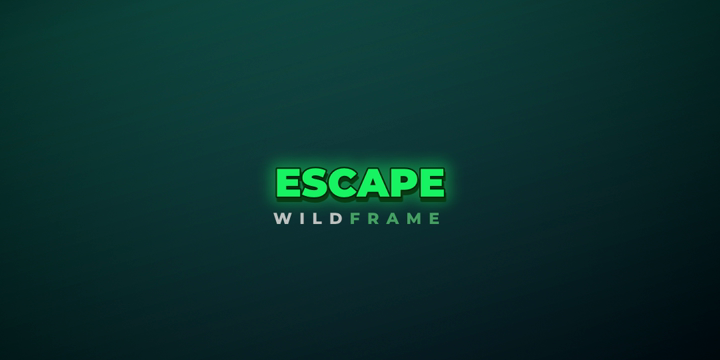

# Tacticalpath → "Center-Punch": an editing system reverse-engineered from a YouTube channel

A forensic reverse-engineering of the editing style of [youtube.com/@Tacticalpath](https://www.youtube.com/@Tacticalpath), turned into a **reproducible production system**: a style bible, presets, a workflow SOP, working templates, and tools that measure the style on any video.



> **Nouveau : [`autoedit`](AUTOEDIT.md), monteur 100 % automatique.** Donnez une vidéo brute, recevez le Short monté dans ce style (sélection de l'histoire, coupes, B-roll, sous-titres, étalonnage, mixage, contrôle qualité) :
> `python -m autoedit ma_video.mp4` ou `python -m autoedit --watch inbox --out outbox`. Guide en français : [AUTOEDIT.md](AUTOEDIT.md). **Interface web** : `start-studio.bat` (Windows) ou `./start-studio.sh`.

## What the channel actually is

`@Tacticalpath` is **not** a tactical or military channel. It is a **Shorts-only wildlife-podcast clip channel** (~55 K subscribers, ≥ 55 Shorts, 21 M views across the first 55). Its grammar, measured on 206 real frames:

| Signature | Value |
|---|---|
| Shot mix | **64–77 % B-roll**, cut to the literal nouns the podcast guest is saying |
| Pace | **≥ 49 cuts/min**, shots ≈ 1 s, **hard cuts only** |
| Captions | 1–3 UPPERCASE words, **Montserrat Black-like**, fill **#19F464**, dark-green hard shadow, centred at **50 % height**, on 100 % of frames |
| Watermark | Two-tone, wide-tracked, **locked 55 px under the caption** |
| Structure | Cold open on the speaker mid-claim; ends on the speaker's last word, so the Short loops |

Audio could not be inspected: YouTube's bot wall blocked streams from the analysis container, and it was not circumvented. Every audio value is labelled as a recommendation. See [`evidence/ACCESS_LOG.md`](evidence/ACCESS_LOG.md).

## Deliverables

**Interactive version:** [`docs/center_punch_style_bible.html`](docs/center_punch_style_bible.html). Open it in a browser for a live 9:16 monitor that plays the 60-s demo edit with the calibrated captions, plus the measured profile, caption anatomy and rules on one page.

| # | Document | What's inside |
|---|---|---|
| 1 | [Channel Analysis Report](docs/01_CHANNEL_ANALYSIS_REPORT.md) | Inventory, sample selection, phases 2–7 with evidence, 44-frame breakdown |
| 2 | [Editing Style Bible](docs/02_EDITING_STYLE_BIBLE.md) | Identity, quantitative profile, visual/audio/story specs, DO / DON'T / OPTIONAL |
| 3 | [Technical Editing Blueprint](docs/03_TECHNICAL_EDITING_BLUEPRINT.md) | Technique recreation in Premiere Pro, DaVinci Resolve, CapCut and FFmpeg; export settings |
| 4 | [Editing Workflow SOP](docs/04_EDITING_WORKFLOW_SOP.md) | 14-step pipeline, folder structure, QC checklist, licensed asset sources |
| 5 | [Preset Specification](docs/05_PRESET_SPECIFICATION.md) | Every font, colour, size, offset, motion, audio and export value |
| 6 | [60-s Demonstration Storyboard](docs/06_DEMO_STORYBOARD_60S.md) | Original script, 52-shot timeline, captions, music and SFX plan; rendered [animatic](demo/animatic_60s.mp4) |
| 7 | [Machine-readable Style Profile](docs/07_style_profile.json) | JSON. Every value carries a `status` (measured / observed / inferred / recommended / unverified) |

## Working templates and tools (all tested)

```
templates/
  captions/make_captions.py     word-timestamp JSON/SRT → calibrated ASS captions + watermark (pop animation)
  luts/crisp_pop_709.cube       33³ finish LUT (+ make_lut.py to regenerate or tweak)
  ffmpeg/reframe_9x16.sh        16:9 podcast → 9:16 A-roll with punch-in zoom
  ffmpeg/blurfill_9x16.sh       letterbox over a blurred fill
  ffmpeg/stack_9x16.sh          top/bottom split-stack
  ffmpeg/still_to_clip.sh       still / AI image → push-in B-roll clip
  ffmpeg/finish_and_export.sh   LUT + sharpen + burn captions + loudnorm + Shorts H.264
  project/create_project.sh     project folder scaffold + licence log
tools/forensics/
  scene_cuts.py                 cuts/min, shot list, opening density, punch-in candidates
  caption_sampler.py            caption position, size and HEX colours from frames or a video
  audio_profile.py              LUFS / true peak / LRA, loudness curve, silences, BPM (librosa), stem balance
  run_all.sh                    all of the above over a folder → reports/SUMMARY.json
demo/
  build_animatic.py             renders the 60-s storyboard end to end with the templates
```

### Quick start

```bash
# 1. captions from word timestamps (WhisperX / faster-whisper / Premiere JSON, or SRT)
python3 templates/captions/make_captions.py words.json captions.ass --brand "YOURBRAND"
```

```bash
# 2. finish + export a 9:16 edit
templates/ffmpeg/finish_and_export.sh edit.mp4 captions.ass short_final.mp4
```

```bash
# 3. measure your own (or legally obtained reference) Shorts against the profile
bash tools/forensics/run_all.sh analysis_input/
```

Requirements: `ffmpeg` (with libass), Python 3.8+, `pip install pillow numpy opencv-python-headless`, and the Montserrat font (SIL OFL).

## Rights and ethics

* The reference channel states that it reposts footage it does not own.
* This repo contains **no frames, audio, scripts or branding from the reference channel**: only measurements, original code, an original demo script and synthetic visuals.
* Use the system with footage you own, licence, or have written permission to clip. [`docs/04 §15`](docs/04_EDITING_WORKFLOW_SOP.md#15-asset-resources-and-licences) lists legal sources and their licence caveats.
